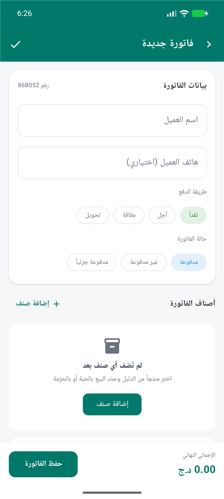
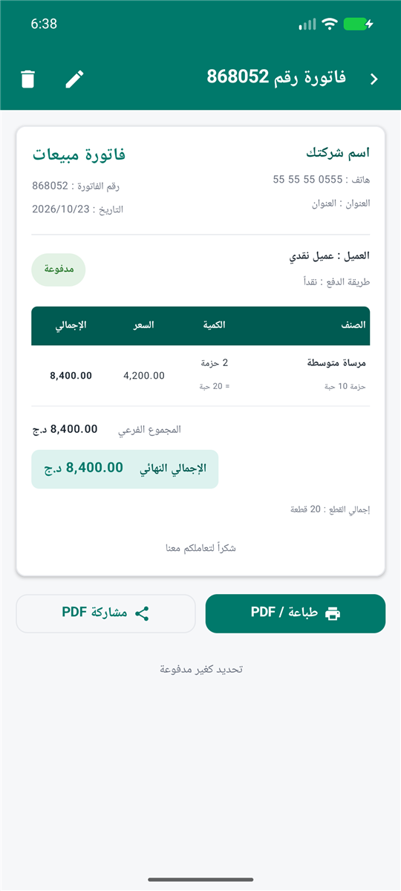
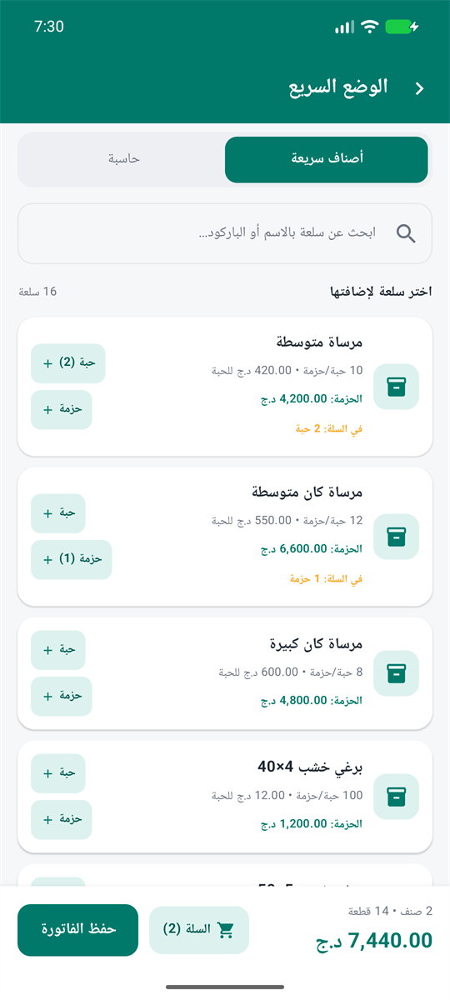
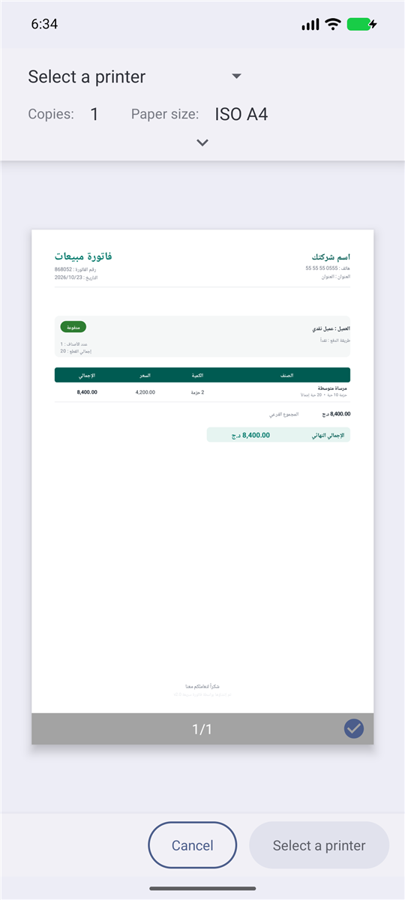

# فاتورة سريعة v2.0

تطبيق أندرويد عربي (RTL) لإدارة الفواتير والمبيعات، مبني بـ Kotlin و Jetpack Compose.

[](https://github.com/madouiqwe/fatoura-saria/actions/workflows/android.yml)

## التنزيل والتثبيت

- **أحدث إصدار (APK):** [github.com/madouiqwe/fatoura-saria/releases/latest](https://github.com/madouiqwe/fatoura-saria/releases/latest)
- **رابط مباشر:** [fatoura-saria-v2.0.apk](https://github.com/madouiqwe/fatoura-saria/releases/download/v2.0/fatoura-saria-v2.0.apk)

للتثبيت: نزّل ملف APK على الهاتف، ثم اسمح بتثبيت التطبيقات من هذا المصدر عند الطلب، وافتح الملف.
التطبيق يعمل دون إنترنت ولا يحتاج إلى حساب، وبياناته محفوظة محلياً على الجهاز.

## لقطات الشاشة

| الرئيسية | دليل السلع |
| --- | --- |
|  |  |

| إنشاء فاتورة | تفاصيل الفاتورة |
| --- | --- |
|  |  |

| الوضع السريع: اختيار السلع | سلة الوضع السريع |
| --- | --- |
|  |  |

| معاينة PDF |
| --- |
|  |

## المميزات

- **حزم بسعات مختلفة لكل منتج**: كل سلعة لها حقل «عدد القطع في الحزمة» مستقل (10، 12، 24 ...).
- **بيع بالحبة أو بالحزمة**: تبديل فوري لوحدة البيع داخل بند الفاتورة، مع حساب عدد القطع تلقائياً.
- **حسابات دقيقة**: سعر الحزمة = سعر الحبة × سعة الحزمة، والإجمالي يُحدَّث لحظياً.
- **فاتورة احترافية**: ترويسة المؤسسة، بيانات العميل، جدول الأصناف، الخصم، المجاميع، وحالة الفاتورة.
- **طباعة وحفظ PDF**: عبر نظام أندرويد (PrintManager) مع دعم كامل للعربية وتشكيل الحروف.
- **مشاركة PDF**: إرسال الفاتورة مباشرة عبر التطبيقات.
- **دليل السلع**: إضافة، تعديل، حذف، بحث، فئات، وباركود.
- **الفواتير المحفوظة**: بحث وتصنيف حسب الحالة وفتح/تعديل/حذف.
- **الوضع السريع**: اضغط «حبة» أو «حزمة» لإضافة السلع إلى سلة، عدّل الكميات، ثم احفظ فاتورة نقدية فوراً. وتضم الشاشة حاسبة لتحويل أي مبلغ إلى فاتورة.
- **إعدادات المؤسسة**: الاسم، الهاتف، العنوان، وعبارة تذييل الفاتورة.
- **تخزين محلي**: كل البيانات في ملف JSON داخل التطبيق (بدون إنترنت أو حساب).

## البناء

```bash
# يتطلب JDK 17 و Android SDK 36
./gradlew assembleDebug
```

ملف APK الناتج:

```
app/build/outputs/apk/debug/app-debug.apk
```

## البنية

```
app/src/main/java/com/madoui/fatoura/
├── data/          # النماذج + التخزين المحلي (JSON)
├── print/         # توليد PDF والطباعة والمشاركة
├── ui/            # الشاشات، المكوّنات، الثيم، التنقل
└── util/          # تنسيق الأرقام والتواريخ
```
